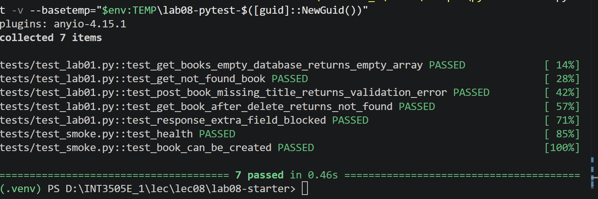
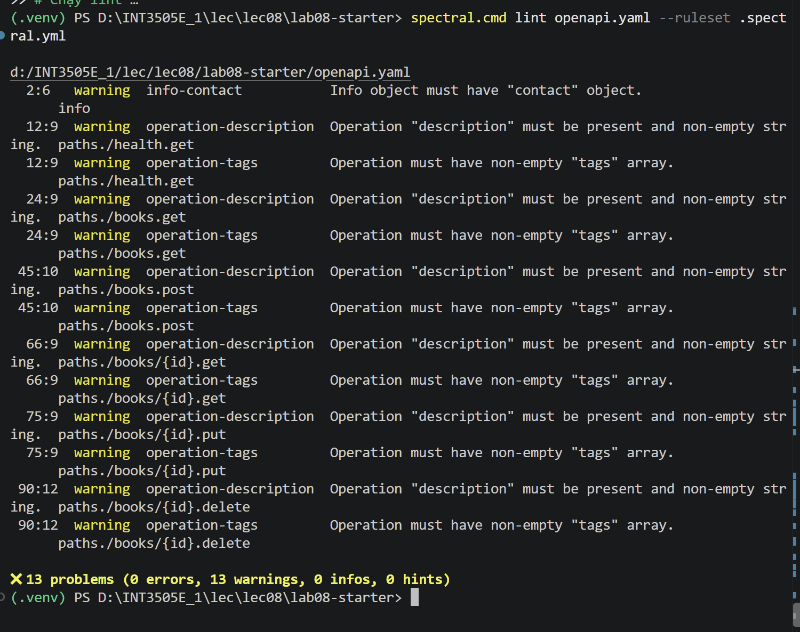
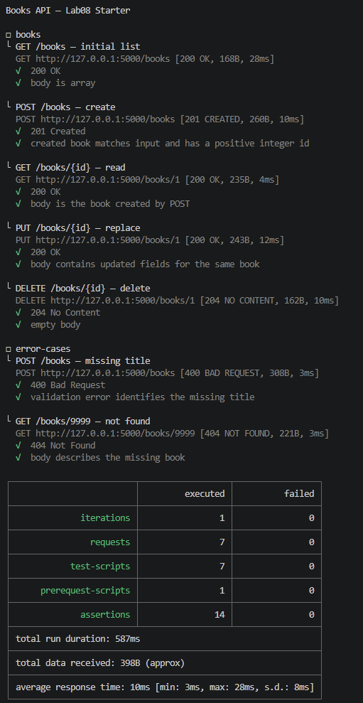

# Lab01 — pytest

Kết quả test:


# Lab02 — OpenAPI/Spectral

Sử dụng Spectral để kiểm tra tài liệu `openapi.yaml` theo bộ quy tắc `spectral:oas` và các custom rule trong `.spectral.yml`.

**Trước khi bổ sung thông tin còn thiếu:** Spectral báo **13 warnings, 0 errors**, gồm thiếu `info.contact`, thiếu `description` và `tags` ở 6 operation.



Đã bổ sung `info.contact`, mô tả và tags cho các operation, đồng thời khai báo hai nhóm tags `Health` và `Books` ở cấp gốc của spec.

File `.spectral.yml` có hai custom rule với mức `error`:

| Custom rule | Trường hợp bị phát hiện | Cách sửa |
|---|---|---|
| `no-content-in-204` | Response HTTP 204 vẫn khai báo trường `content`, kể cả `content: {}` | Bỏ trường `content` khỏi response 204 |
| `response-200-non-empty-schema` | Response HTTP 200 thiếu `content`, `content` rỗng hoặc một media type thiếu `schema`, có `schema: {}` hay `schema: null` | Khai báo content và schema không rỗng cho từng media type |

**Ảnh kết quả sau khi sửa:** Spectral thông báo không tìm thấy lỗi ở mức `error`.

.png>)
.png>)

Kết quả: **0 warnings, 0 errors**

# Lab03 — Postman/Newman

Đã hoàn thành 5 happy-path requests và folder `error-cases` gồm POST thiếu `title` (400) và GET `/books/9999` (404). Mỗi request có 2 `pm.test`: status và body. POST lưu `book_id` bằng `pm.collectionVariables`, GET/PUT/DELETE dùng lại ID này.

| Folder | Request | Status | Kiểm tra body |
|---|---|---|---|
| books | GET `/books` | 200 | JSON array |
| books | POST `/books` | 201 | Đúng dữ liệu tạo, `id` nguyên dương |
| books | GET `/books/{{book_id}}` | 200 | Đúng sách vừa tạo |
| books | PUT `/books/{{book_id}}` | 200 | Đúng ID và nội dung cập nhật |
| books | DELETE `/books/{{book_id}}` | 204 | Body rỗng |
| error-cases | POST `/books` thiếu `title` | 400 | `VALIDATION_ERROR`, `Invalid book data`, chi tiết thiếu `title` |
| error-cases | GET `/books/9999` | 404 | `NOT_FOUND`, `Book not found` |

POST xóa `book_id` cũ trước khi chạy và lưu ID mới bằng `pm.collectionVariables.set("book_id", book.id)` khi response hợp lệ

Kết quả chạy thực tế ngày 17/11/2026:


- 7 requests, 14 assertions, 0 failures.
- [JUnit report](reports/junit.xml) có **14 phần tử `testcase`**, không có failure/error.

```powershell
newman.cmd run books-api.postman_collection.json -e postman/local.postman_environment.json -r cli,junit --reporter-junit-export reports/junit.xml
```

# Lab04 — Locust

Đã thêm `search_by_year(year=None)`, kiểm tra response tìm sách đúng năm và đánh dấu lỗi giả lập với xác suất 1% trên mỗi search hợp lệ. Lỗi được tạo bằng `response.failure()` phía Locust, **không phải HTTP 500 thật từ Flask**. POST tạo sách có năm để phục vụ task tìm kiếm.

Đã chạy A → B → C ngày 17/11/2026 trên **API đang chạy tại `http://127.0.0.1:5000`**, cùng database hiện có:

| Kịch bản | Users | Duration | Requests | p95 tổng | RPS | Failures |
|---|---:|---:|---:|---:|---:|---:|
| [A](reports/A.html) | 10 | 30s | 140 | 12 ms | 4,77 | 1 giả lập |
| [B](reports/B.html) | 50 | 60s | 1396 | 12 ms | 23,43 | 2 giả lập |
| [C](reports/C.html) | 200 | 30s | 2883 | 73 ms | 97,47 | 0 |

Cả ba lượt đạt p95 < 300 ms trong môi trường local; chưa thể suy ra SLO production. C có p95 tổng cao nhất. Không ghi nhận failure ngoài giả lập; 404 dự kiến của task đọc ID ngẫu nhiên được coi là hợp lệ. Các lượt POST đã thêm 639 sách thử vào database. C không gặp lỗi giả lập là một kết quả ngẫu nhiên hợp lệ, không phải đã tắt cấu hình 1%.

- [Phân tích đầy đủ và câu hỏi bonus](performance/analysis.md).
- [Số liệu cuối lượt trích từ HTML](reports/lab4-summary.json).
